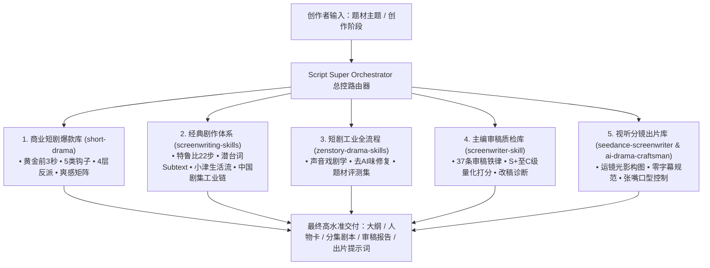

# 剧本创作总控引擎 (Script Super Orchestrator)

> **全网最全影视剧本与微短剧创作总控中枢**。本技能打通了 **学院派经典剧作理论**、**爆款商业短剧机制**、**毒舌主编审稿系统** 与 **AI 视频生成视听规约**，通过智能路由器，根据创作者当前提出的剧本题材、故事母题与制作阶段，自适应激活并协同调用对应的专业子知识库。

---

## 🎯 核心架构与 5 大底层知识库集群

总控引擎统筹调度本地已挂载的 5 大专业知识库与 40+ 专项剧作法：

---

## 🧭 主题与题材智能调度矩阵 (Theme & Genre Routing)

根据用户剧本的**主题定位与情感基调**，总控引擎自动分配对应的知识库法则：

| 剧本主题 / 题材 | 核心情感与调性 | 自动调度的核心子技能与知识库 | 核心指导文档 |
| :--- | :--- | :--- | :--- |
| **市井生活流 / 温情治愈** *(例：《水开见喜》)* | 烟火气、器物叙事、东方留白、深层羁绊 | `screenwriting-skills/ozu-screenplay-style` `zenstory-drama-skills/scene-sound-dramaturgy` `zenstory-drama-skills/anti-template-repair` | [01-theme-genre-matrix.md](./references/01-theme-genre-matrix.md) |
| **都市逆袭 / 战神打脸 / 商业爽剧** | 极致憋屈、高压释放、身份反转、阶级对立 | `short-drama/opening-rules` `short-drama/satisfaction-matrix` `short-drama/villain-design` `short-drama/hook-design` | [01-theme-genre-matrix.md](./references/01-theme-genre-matrix.md) |
| **悬疑反转 / 犯罪推理** | 悬念钩、信息差、伏笔回收、惊悚危机 | `short-drama/hook-design` (信息差钩) `screenwriting-skills/sw-truby-anatomy` `danjdewhurst/story-skills` (伏笔编译器) | [01-theme-genre-matrix.md](./references/01-theme-genre-matrix.md) |
| **多线博弈 / 家族权谋 / 职场内卷** | 话里藏刀、群像张力、利益博弈、潜流涌动 | `screenwriting-skills/succession-series-writing` `screenwriting-skills/sw-dialogue` (Subtext) `screenwriting-skills/sw-character-conflict` | [01-theme-genre-matrix.md](./references/01-theme-genre-matrix.md) |
| **轻喜剧 / 市井幽默 / 错位连环** | 动机错位、因果滚雪球、性格反差 | `screenwriting-skills/sw-sitcom-comedy` `screenwriting-skills/sw-scene-craft` `screenwriter-skill/iron_rules.md` | [01-theme-genre-matrix.md](./references/01-theme-genre-matrix.md) |

---

## ⚙️ 创作全流程六阶段执行状态机 (Lifecycle State Machine)

创作者在任一阶段提出诉求，总控引擎严格遵循该阶段的行业级交付标准：

### 阶段 1：选题立项与题材雷达 (Logline & Premise)
- **调度技能**：`short-drama/genre-guide` + `screenwriting-skills/sw-premise-theme`
- **核心动作**：
  - 提炼一句话核心梗概（Logline：主角 + 核心困境 + 独特筹码 + 终极目标）。
  - 确立核心哲学对抗（Theme：例如传统匠心烟火 vs 冰冷极简资本）。
  - 执行题材平台合规预检（广电与主流平台红线）。

### 阶段 2：故事骨架与人物小传 (Bible & Arc)
- **调度技能**：`screenwriting-skills/sw-truby-anatomy` + `short-drama/villain-design` + `sw-character-conflict`
- **核心动作**：
  - **主角弧光三要素**：心理创伤 (Ghost) + 表面欲求 (Want) + 真正内在需要 (Need)。
  - **四层反派体系**：第一层爪牙刁难 → 第二层直接利益冲突 → 第三层体制/观念压迫 → 第四层内心心魔。
  - 生成标准人物卡文档，使用 [01-character-bible-template.md](./templates/01-character-bible-template.md)。

### 阶段 3：分集大纲与心电图卡点 (Beat Sheet & Hooks)
- **调度技能**：`short-drama/opening-rules` + `hook-design` + `rhythm-curve` + `paywall-design`
- **核心动作**：
  - **前 3 秒黄金 Hook**：拒绝冗长铺垫，首镜必须有强动作冲量或剧烈危机（摔落、藏壶、撞门）。
  - **集尾断章 5 种钩子**：每集结尾强制卡在悬念点，禁止闭环解决。
  - **卡点节奏心电图**：第 1 集立局 → 第 7-10 集付费卡点/重大危机 → 终极大战。
  - 输出标准分集大纲，使用 [02-episode-outline-template.md](./templates/02-episode-outline-template.md)。

### 阶段 4：逐场剧本创作与潜台词锤炼 (Scene Craft & Subtext)
- **调度技能**：`screenwriting-skills/sw-dialogue` + `sw-scene-craft` + `zenstory-drama-skills/dialogue-craft`
- **核心动作**：
  - **单场戏价值翻转**：每场戏入场与出场必须发生正负情绪/权力值的转变（+ ➔ - 或 - ➔ +）。
  - **潜台词去说明化（Anti-On-The-Nose）**：严禁角色直白倾倒信息，把内心真实想法隐藏在子文本（Subtext）中，用身体动作和眼神传递。
  - **声音戏剧学赋能**：用环境声（Foley、铜壶鸣叫、卷尺收缩、玻璃碎裂）代替旁白解说。
  - 输出标准分场台本，使用 [03-scene-script-template.md](./templates/03-scene-script-template.md)。

### 阶段 5：主编级审稿质检与反套路去 AI 味 (Review & Iron Rules)
- **调度技能**：`screenwriter-skill` (37条铁律) + `zenstory-drama-skills/anti-template-repair`
- **核心动作**：
  - 启动 **37 条行业毒舌审稿铁律** 逐项排查（检查：反派智商是否在线、对白是否水、动机是否过家家）。
  - **去 AI 味专项修复**：清除 AI 常用的大段抒情、假大空排比、逻辑假高潮，注入真实生活细节与市井俚语。
  - 输出 S+ 至 C 级诊断评审报告，使用 [04-review-report-template.md](./templates/04-review-report-template.md)。

### 阶段 6：视听分镜转译与 AI 出片规约 (Storyboard & Prompts)
- **调度技能**：`seedance-screenwriter` + `ai-drama-craftsman` + `zenstory-drama-skills/short-drama-video-prompts`
- **核心动作**：
  - 将文学剧本 1:1 转译为 AI 视频生成提示词（以 Seedance 2.0 Fast / 2.5 为基准）。
  - 严格遵守**零字幕底片规范**（去台词与引号）与**张嘴口型控制 Token**。
  - 光学参数锁定（焦段、机位高度、侧向体积切光、胶片颗粒）。

---

## 🛠️ 快捷指令集 (Quick Commands)

创作者可随时使用以下指令唤醒总控技能特定流程：

- `/plan [题材/脑洞]`：启动阶段 1 & 2，进行主题分类、人物小传与核心故事骨架规划。
- `/outline [集数]`：启动阶段 3，规划分集节拍表与每集黄金 Hook / 集尾断章钩子。
- `/write [集号]`：启动阶段 4，按照潜台词与声音戏剧学规范生成正文剧本。
- `/review [剧本内容]`：启动阶段 5，调用 37 条审稿铁律进行 S+ 级严苛诊断并输出改稿方案。
- `/prompt [分镜]`：启动阶段 6，将剧本动作无缝转译为 Seedance 2.0 / 2.5 工业级提示词。

---

## 📂 知识库索引与参考文档

- [主题与题材调度矩阵](./references/01-theme-genre-matrix.md)
- [六阶段全流程调度规范](./references/02-lifecycle-orchestrator.md)
- [子技能与知识库物理映射清单](./references/03-subskills-dispatch-map.md)
- [37条审稿铁律与去AI味红线](./references/04-iron-rules-and-anti-ai.md)
